  
  
  

  
  
  

## 🐿️ About me

Online, I go by **Mr. Squirrely**. I love creating all types of things, from desktop software and web components to game dev tools. Right now I'm learning Unity to build a video game, and making dedicated tools for story writing and worldbuilding along the way.

> [!NOTE]
> **On AI & coding:** I use AI to craft code, I know how to code myself but honestly the AI does it far better than I ever could, I test everything before it gets merged.

## 🔭 What I'm working on

<table>
  <tr>
    <td width="50%" valign="top">
      <h3>📖 <a href="https://github.com/MrSquirrely/WritingIDE">WritingIDE</a></h3>
      An IDE for novelists, modelled on Visual Studio: chapters, story elements, IntelliSense for your world, a grammar engine, planning tools and plugins.
        
      
      
    </td>
    <td width="50%" valign="top">
      <h3>🧩 <a href="https://github.com/MrSquirrely/WritingIDE-Plugins">WritingIDE Plugins</a></h3>
      Plugins for WritingIDE: ambient soundscapes, a map maker, gamification and genre rule packs.
        
      
      
    </td>
  </tr>
  <tr>
    <td width="50%" valign="top">
      <h3>🚩 <a href="https://github.com/MrSquirrely/Flags">Flags</a></h3>
      A Razor component library that renders waving, animated flags in web apps.
        
      
      
    </td>
    <td width="50%" valign="top">
      <h3>📺 <a href="https://github.com/MrSquirrely/AsciiConverter">Ascii Converter</a></h3>
      A utility that converts video into live ASCII art text.
        
      
      
    </td>
  </tr>
</table>

## ⚡ Recent activity

<!--START_SECTION:activity-->
1. 🗣 Commented on [#72](https://github.com/MrSquirrely/MuzzleUI/issues/72#issuecomment-7198591434) in [MrSquirrely/MuzzleUI](https://github.com/MrSquirrely/MuzzleUI)
2. 🗣 Commented on [#71](https://github.com/MrSquirrely/MuzzleUI/issues/71#issuecomment-7198591048) in [MrSquirrely/MuzzleUI](https://github.com/MrSquirrely/MuzzleUI)
3. ℹ️ Labeled issue [#72](https://github.com/MrSquirrely/MuzzleUI/issues/72) in [MrSquirrely/MuzzleUI](https://github.com/MrSquirrely/MuzzleUI)
4. ❗ Opened issue [#72](https://github.com/MrSquirrely/MuzzleUI/issues/72) in [MrSquirrely/MuzzleUI](https://github.com/MrSquirrely/MuzzleUI)
5. ℹ️ Labeled issue [#71](https://github.com/MrSquirrely/MuzzleUI/issues/71) in [MrSquirrely/MuzzleUI](https://github.com/MrSquirrely/MuzzleUI)
6. ❗ Opened issue [#71](https://github.com/MrSquirrely/MuzzleUI/issues/71) in [MrSquirrely/MuzzleUI](https://github.com/MrSquirrely/MuzzleUI)
<!--END_SECTION:activity-->

## 🛠️ Tech stack & tooling

  

`C#` • `.NET` • `WPF` • `XAML` • `Razor` • `Unity`

## 🐍 My contributions, as a snack

  <picture>
    <source media="(prefers-color-scheme: dark)" srcset="https://raw.githubusercontent.com/MrSquirrely/MrSquirrely/output/snake-dark.svg">
    <source media="(prefers-color-scheme: light)" srcset="https://raw.githubusercontent.com/MrSquirrely/MrSquirrely/output/snake.svg">
    
  </picture>

## 🌐 Around the web

- 🏠 **[Main website](https://mrsquirrely.net)**
- 🎨 **[Game studio](https://squeakroar.com)**
- 🔗 **[Short URL platform](https://awoo.li/)**
- 🎮 **[Gaming server](http://treehouse.li/)**

## 💬 Quick info

- 😄 **Pronouns:** He/Him
- 💖💛💙 **Identity:** Pan Pride
- 📍 **Location:** Indiana

🌰 <b>Squirrel fact</b> (click to crack it open)

 

Squirrels accidentally plant thousands of new trees every year simply by forgetting where they buried their acorns!

